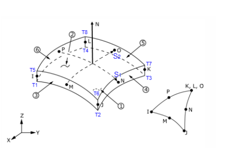

.. _specification:

Format specifications
=====================

This document defines the specifications for the HDF5 composite CAE format. Use this format to exchange composite layup data between computer-aided engineering (CAE) tools.

Use the following concepts in this format:

* **Mesh**: A mesh stores geometric information consisting of nodes and elements.
* **Component**: A component represents a layer in the composite structure. Each component references a mesh and data map.
* **Data map**: A data map stores data for each element or node in a mesh, including thickness, reference direction, and fiber direction.

.. note::
    HDF5 is a binary format. Use a viewer such as `HDFView <https://www.hdfgroup.org/download-hdfview/>`__ to inspect file contents.

Tree overview
-------------

.. figure:: _static/tree.png
   :target: _static/tree.png
   :alt: HDF5 composite CAE specification tree
   :width: 600px
   :align: center

   Click to view full size.

General information
-------------------

This section describes general information about the HDF5 composite CAE format.

Node types in HDF5 tree
~~~~~~~~~~~~~~~~~~~~~~~

.. list-table::
   :header-rows: 1
   :widths: 20 55 25

   * - Node type
     - Definition
     - Examples
   * - Container node
     - A group node that contains object nodes of the same type.
     - fabrics, meshes, rosettes
   * - Named object node
     - Represents a single object. To avoid HDF5 naming restrictions, store the external object name in the ``title`` attribute. Store object data in attributes or attached data nodes.
     - fabric, mesh, rosette
   * - Link node
     - A link node stores dependencies between nodes in the tree.
     -
   * - Data node
     - A data node stores array or scalar values in its attributes.
     -

.. important::

   To support interoperability with high-level interfaces such as PyTables, use HDF5 node names that match the Perl-compatible regular expression:

   ``^[a-zA-Z_][a-zA-Z0-9_]*$``

   Node names must be unique within a group.

**General rule:** all string attributes use UTF-8 encoding.

Root-level nodes
----------------

composite_cae
~~~~~~~~~~~~~

**Path:** ``composite_cae``

All attributes are optional.

.. list-table::
   :widths: 25 15 60
   :header-rows: 1

   * - Attribute
     - Type
     - Values
   * - ``format_version``
     - string
     - 1.0
   * - ``last_modified``
     - datestring
     - "2010-08-23 13:31:13Z"
   * - ``vendor``
     - string
     - "ansys, inc."
   * - ``unit_system``
     - string
     - "SI", "Imperial"
   * - ``length_unit``
     - string
     - "m", "cm", "mm", "um", "in"
   * - ``mass_unit``
     - string
     - "kg", "t", "g", "lbf", "lbm"
   * - ``time_unit``
     - string
     - "s"
   * - ``temp_unit``
     - string
     - "C", "K", "F"
   * - ``angles``
     - string
     - "deg", "rad"

If ``unit_system`` is not specified, the importer uses its default unit system.
The ``*_unit`` attributes override ``unit_system``.

For example, if ``unit_system`` is "SI" and ``length_unit`` is "mm", the length unit is "mm".

Global coordinate system
~~~~~~~~~~~~~~~~~~~~~~~~

**Path:** ``composite_cae → global_coord_sys``

.. list-table::
   :header-rows: 1

   * - Field
     - Type
     - Description
   * - ``global_coord_sys``
     - 4×3 double array
     - Defines origin and directions for the entire model: ``[origin]``, ``[dir1]``, ``[dir2]``, and ``[dir3]`` with x/y/z components.

Ansys does not currently support this attribute.

Material data
-------------

Fabric (named)
~~~~~~~~~~~~~~

**Path:** ``material_data → fabrics → fabric(named)``

Orientations (obsolete)
~~~~~~~~~~~~~~~~~~~~~~~

**Path:** ``material_data → fabrics → fabric(named) → orientations (obsolete)``

Array of doubles.

.. code-block:: text

   [0, 45, -45]

.. note::
  Ansys does not read or write this property. This property may be removed in a future release.

Mechanical
~~~~~~~~~~

**Path:** ``material_data → fabrics → fabric(named) → mechanical``

.. list-table::
   :widths: 30 20 50
   :header-rows: 1

   * - Attribute
     - Type
     - Description
   * - ``architecture``
     - string (optional)
     - uni, woven
   * - ``weight_per_area``
     - double
     -
   * - ``cured_thickness``
     - double
     -
   * - ``E1``
     - double (optional)
     -
   * - ``E2``
     - double (optional)
     -
   * - ``E3``
     - double (optional)
     -
   * - ``G12``
     - double (optional)
     -
   * - ``G23``
     - double (optional)
     -
   * - ``G31``
     - double (optional)
     -
   * - ``v12``
     - double (optional)
     -
   * - ``v13``
     - double (optional)
     -
   * - ``v23``
     - double (optional)
     -
   * - ``alpha1``
     - double (optional)
     -
   * - ``alpha2``
     - double (optional)
     -
   * - ``alpha_ref_temp``
     - double (optional)
     -

Cost
~~~~

**Path:** ``material_data → fabrics → fabric(named) → cost``

.. list-table::
   :widths: 30 20 50
   :header-rows: 1

   * - Attribute
     - Type
     - Description
   * - ``currency``
     - string
     - EUR, USD, etc.
   * - ``cost_per_area``
     - double
     -

Stackup (named)
~~~~~~~~~~~~~~~

**Path:** ``material_data → stackups → stackup(named)``

Cost
~~~~

**Path:** ``material_data → stackups → stackup(named) → cost``

.. list-table::
   :widths: 30 20 50
   :header-rows: 1

   * - Attribute
     - Type
     - Description
   * - ``currency``
     - string
     - EUR, USD, etc.
   * - ``cost_per_area``
     - double
     -

Fabric
~~~~~~

**Path:** ``material_data → stackups → stackup(named) → fabric``

.. list-table::
   :widths: 30 20 50
   :header-rows: 1

   * - Attribute
     - Type
     - Description
   * - ``number``
     - unsigned
     - Defines the order of fabrics within the stackup.
   * - ``angle``
     - double
     - Angle of the fabric within the stackup.

Meshes
------

Mesh (named)
~~~~~~~~~~~~

**Path:** ``meshes → mesh(named)``

Node labels
~~~~~~~~~~~

**Path:** ``meshes → mesh(named) → node_labels``

.. list-table::
   :header-rows: 1

   * - Field
     - Type
     - Description
   * - ``node_labels``
     - n×1 integer array
     - Unique node identifiers.

Nodes
~~~~~

**Path:** ``meshes → mesh(named) → nodes``

.. list-table::
   :header-rows: 1

   * - Field
     - Type
     - Description
   * - ``nodes``
     - n×3 double array
     - Node coordinates ``(x, y, z)``.

Element labels
~~~~~~~~~~~~~~

**Path:** ``meshes → mesh(named) → element_labels``

.. list-table::
   :header-rows: 1

   * - Field
     - Type
     - Description
   * - ``element_labels``
     - n×1 integer array
     - Unique element identifiers.

.. _meshes_element_types:

Element types
~~~~~~~~~~~~~

**Path:** ``meshes → mesh(named) → element_types``

.. list-table::
   :header-rows: 1

   * - Field
     - Type
     - Description
   * - ``element_types``
     - n×1 integer array
     - Element type identifier for each element.

Supported element types:

- 3-node shell
- 4-node shell
- 6-node shell
- 8-node shell

The list of element types may expand in future releases, for example with 108 and 120 for 8-node and 20-node bricks.

Element nodes
~~~~~~~~~~~~~

**Path:** ``meshes → mesh(named) → element_nodes``

.. list-table::
   :header-rows: 1

   * - Field
     - Type
     - Description
   * - ``element_nodes``
     - n×m variable-length integer array (VLArray)
     - Node indices for each element.

Defines element nodes. Node indices point directly to entries in the nodes and node_labels arrays.

Node order must follow the indices shown below:

- 3 nodes (linear triangle): I, J, K
- 4 nodes (linear rectangle): I, J, K, L
- 6 nodes (quadratic triangle): I, J, K, M, N, P
- 8 nodes (quadratic rectangle): I, J, K, L, M, N, O, P

   Click to view full size.

.. note::
  A VLArray is used to support different element types (see :ref:`meshes → mesh(named) → element_types <meshes_element_types>`).

Edge set (named)
~~~~~~~~~~~~~~~~

**Path:** ``meshes → mesh(named) → edge_sets → edge_set(named)``

.. list-table::
   :header-rows: 1

   * - Field
     - Type
     - Description
   * - ``edge_set``
     - n×1 unsigned integer array
     - Node indices that reference nodes in this set.

Element set (named)
~~~~~~~~~~~~~~~~~~~

**Path:** ``meshes → mesh(named) → element_sets → element_set(named)``

.. list-table::
   :header-rows: 1

   * - Field
     - Type
     - Description
   * - ``element_set``
     - n×1 unsigned integer array
     - Element indices that reference elements in this set.

Components
----------

Component (named)
~~~~~~~~~~~~~~~~~

**Path:** ``components → component(named)``

Attributes:

.. list-table::
   :widths: 30 20 50
   :header-rows: 1

   * - Attribute
     - Type
     - Description
   * - ``type``
     - string
     - ply, core, etc.
   * - ``layer_id``
     - integer
     - The step value and global identifier. It defines ply order from bottom to top.
   * - ``orientation``
     - double
     - The nominal orientation angle relative to the reference direction.
   * - ``mapping_type``
     - string
     -

.. note::
   The mapping_type attribute is optional and is detailed later. Because ACP can use multiple rosettes
   to define a ply's reference direction, several mapping types are defined, including interpolation algorithms such as "minimum distance" and "minimum angle."

Placement coordinate system
~~~~~~~~~~~~~~~~~~~~~~~~~~~

**Path:** ``components → component(named) → placement_coord_sys``

.. list-table::
   :header-rows: 1

   * - Field
     - Type
     - Description
   * - ``placement_coord_sys``
     - 4×3 double array
     - Placement coordinate system rows: ``[origin]``, ``[dir1]``, ``[dir2]``, and ``[normal]`` with x/y/z components.

The placement_coord_sys has two purposes:

- Its normal defines the default offset direction of the layup.
- Its origin and dir1 define the starting point and initial direction of the draping calculation.

Material
~~~~~~~~

**Path:** ``components → component(named) → material``

**Softlink**

Defines the ply material and refers to an object in ``material_data → fabrics`` or ``material_data → stackups``.

Element set
~~~~~~~~~~~

**Path:** ``components → component(named) → element_set``

**Softlink**

Defines a link to an element set of a mesh and specifies the ply extent.

Data map
~~~~~~~~

**Path:** ``components → component(named) → data_map``

**Softlink**

Defines a link to the data map of this component.

The following rules apply:

- If the data map contains a thickness, a material of type ``material_data → stackups`` is not supported.
- If ``data_map → thickness`` is not defined, thickness is computed from ``cured_thickness`` when the material is a fabric, or from the sum of all ``cured_thickness`` values when ``material_data → stackups``.
- If ``matorient_1_angles`` is not present, it is set equal to ``component → orientation``.
- If ``matorient_2_angles`` is not present, it is computed as: ``matorient_2_angles = matorient_1_angles + 90°``.

Rosette (named)
~~~~~~~~~~~~~~~

**Path:** ``components → component(named) → rosettes → rosette(named)``

**Softlink (Optional)**

Defines a link to the rosettes of this component.

Rosettes
--------

Rosette (named)
~~~~~~~~~~~~~~~

**Path:** ``rosettes → rosette(named)``

Attributes:

.. list-table::
   :widths: 30 20 50
   :header-rows: 1

   * - Attribute
     - Type
     - Description
   * - ``mapping_type``
     - string
     -

.. note::
   The possible values of the rosette mapping_type are not yet specified. FiberSIM defines the mapping types as "translational", "standard", or "rotational".
   ACP defines the standard rosette types as "parallel", "radial", "cylindrical", or "spherical". The exact definition of this attribute has been postponed
   because this information is optional and is not required to map the ply orientation field correctly.

Coordinate system
~~~~~~~~~~~~~~~~~

**Path:** ``rosettes → rosette(named) → coord_sys``

.. list-table::
   :header-rows: 1

   * - Field
     - Type
     - Description
   * - ``coord_sys``
     - 4×3 double array
     - Rosette coordinate system rows: ``[origin]``, ``[dir1]``, ``[dir2]``, and ``[normal]`` with x/y/z components.

Data maps
---------

Data map (named)
~~~~~~~~~~~~~~~~

**Path:** ``data_maps → data_map(named)``

Element/node set link
~~~~~~~~~~~~~~~~~~~~~

**Path:** ``data_maps → data_map(named) → element_set/node/node_set``

.. list-table::
   :header-rows: 1

   * - Field
     - Type
     - Description
   * - ``element_set`` / ``node_set``
     - softlink
     - Link to a mesh element set or edge set where orientations, thicknesses, and other values are defined.

Reference directions
~~~~~~~~~~~~~~~~~~~~

**Path:** ``data_maps → data_map(named) → reference_directions``

.. list-table::
   :header-rows: 1

   * - Field
     - Type
     - Description
   * - ``reference_directions``
     - n×3 double array
     - Reference directions as absolute direction vectors.

Normals
~~~~~~~

**Path:** ``data_maps → data_map(named) → normals``

.. list-table::
   :header-rows: 1

   * - Field
     - Type
     - Description
   * - ``normals``
     - n×3 double array (optional)
     - Normal directions as absolute vectors used to project the reference direction onto the normal plane.

Matorient 1 angles
~~~~~~~~~~~~~~~~~~

**Path:** ``data_maps → data_map(named) → matorient_1_angles``

.. list-table::
   :header-rows: 1

   * - Field
     - Type
     - Description
   * - ``matorient_1_angles``
     - n×1 double array (optional)
     - Material orientation 1 angles relative to the reference direction and given normal.

Matorient 2 angles
~~~~~~~~~~~~~~~~~~

**Path:** ``data_maps → data_map(named) → matorient_2_angles``

.. list-table::
   :header-rows: 1

   * - Field
     - Type
     - Description
   * - ``matorient_2_angles``
     - n×1 double array (optional)
     - Material orientation 2 angles relative to the reference direction and given normal.

Thicknesses
~~~~~~~~~~~

**Path:** ``data_maps → data_map(named) → thicknesses``

.. list-table::
   :header-rows: 1

   * - Field
     - Type
     - Description
   * - ``thicknesses``
     - n×1 double array (optional)
     - Position-dependent thickness values.

Scalar user data (named)
~~~~~~~~~~~~~~~~~~~~~~~~

**Path:** ``data_maps → data_map(named) → scalar_user_data → scalar_user_data(named)``

.. list-table::
   :header-rows: 1

   * - Field
     - Type
     - Description
   * - ``scalar_user_data``
     - n×1 double array (optional)
     - User-defined scalar data field. Only supported by Ansys.

.. list-table::
   :widths: 30 20 50
   :header-rows: 1

   * - Attribute
     - Type
     - Values
   * - ``unit_type``
     - string
     - "dimensionless", "length", "mass", "time", "temp" (default: "dimensionless")

Component groups
----------------

Component group (named)
~~~~~~~~~~~~~~~~~~~~~~~

**Path:** ``component_groups → component_group(named)``

Component groups are optional. You can define them to store grouping information of components.

Change log
----------

.. list-table::
   :widths: 15 50
   :header-rows: 1

   * - Date
     - Description
   * - May 5, 2010
     - ACP–FiberSIM Interface Format Specification Rev 01
   * - June 5, 2010
     - HDF5 Composite CAE Data File Specification Proposal version 1.1
   * - Aug 10, 2010
     - HDF5 Composite CAE Data File Specification Release Candidate 1 for stable version 1.0.
   * - Aug 11, 2010
     - Minor updates in "Open Questions", added Section "Specification of Node Names"
   * - Aug 30, 2010
     - Upgrade specification to match all issues recently discussed with Vistagy via emails
   * - Mar 17, 2011
     - Cleanup the document a little
   * - Oct 17, 2014
     - Adding component_groups and component_group nodes
   * - June 28, 2019
     - Adding some additional information
   * - January 24, 2020
     - Corrected name for matorient_angles: "mat_orient1_angles" to "matorient_1_angles" and "mat_orient2_angles" to "matorient_2_angles". Defined which fields in data_map are optional and specify what happens if optional nodes are missing. Clarified use of placement_coord_sys
   * - September 15, 2020
     - Mentioned that global_coord_sys is currently not supported. Correct what happens when matorient_1_angles are not present
   * - January 26, 2022
     - Mark ``material_data->fabrics->fabric(named)->orientations`` as obsolete
   * - February 4, 2022
     - Change Href to Softlink for items that have to be linked with a Softlink
   * - February 8, 2022
     - Correct datatype for element_labels, element_nodes and element_types (now int), clarified layer id
   * - February 17, 2022
     - Clarified units specification, Mark optional material properties as optional
   * - May 12, 2022
     - Add optional scalar_user_data data_map property
   * - May 31, 2022
     - Improved formatting, Removed outdated future plans section. Added missing rosettes in component
   * - May 22, 2023
     - Improve documentation of node order
   * - May 15, 2024
     - Complete supported units
   * - June 21, 2024
     - Clarified orientation
   * - April 14, 2024
     - Some clarifications

